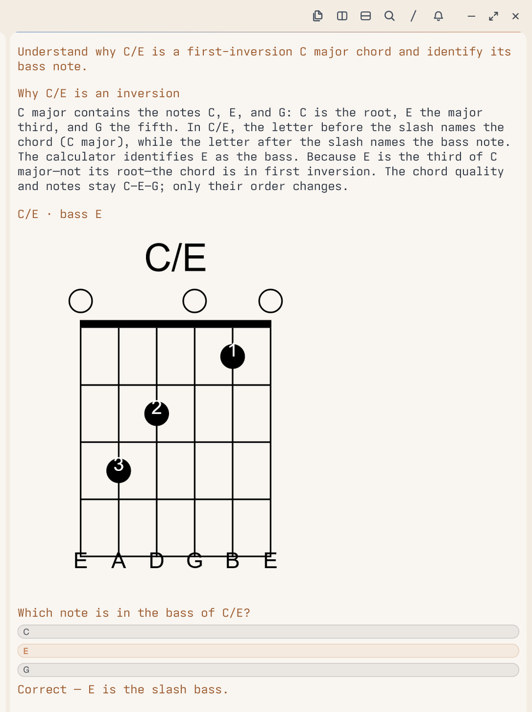

# Tern Guitar Score (`gscore`)

Interactive guitar tablature player and practice companion for [Tern](https://docs.stencil.so/tern/),
built on alphaTab (layout + SoundFont synthesis) and a resident mpv audio engine.


## What it does

- **Import & inspect.** Open `.musicxml`, `.xml`, `.mxl`, `.gp`, `.gp3`, `.gp4`, `.gp5`, and `.gpx`; all eight are exercised end to end (import, render, audio, interactive notes).
- **Play.** alphaTab's bundled Sonivox SoundFont produces normalized 44.1 kHz stereo WAV; mpv supplies the audio clock, transport, note seek, measure and A–B loops, and pitch-preserving 0.75×/1.0×/1.25× speed.
- **Count and keep time.** Use a one-bar count-in or toggle the live metronome while playing.
- **Generate practice.** Turn selected measures into alternate-picking, arpeggio, or slow-drill MusicXML; each request keeps its own selection snapshot.
- **Compare and follow.** Keep the source and multiple drafts open side by side; linked measures stay aligned, playback reveals the current system, and resizing reflows notation without regenerating audio.
- **Mix.** Mute or solo separable MIDI tracks; the live metronome follows the current track mix.
- **Agent context.** `selection.json` (`music_context_v1`) exports stable note ids, string/fret, absolute MIDI, durations, tuplets, ties, hammer-ons, slides, tuning, and time signature.
- **Dynamic lessons (P4-B).** Explicit `gscore.lesson.v1` compatibility plus a strict v2 chord-comparison slice: calculator-resolved C/C/E shapes, lowest-note diagrams with clickable pitch hitboxes, fact-derived quiz answers, and immutable revision-scoped attempts.

## Architecture

Four layers own the score/playback path:

```
Tern Native UI (Luau)        score panes, hit boxes, toolbar, viewport links
  ↓
Practice Controller (Luau)   transport, measure links, follow, mix state
  ↓
Score Engine (alphaTab)      layout, MIDI, PNG systems, WAV stems and click
  ↓
Audio Engine (mpv + IPC)     playback, seek, speed, loop, transport-preserving mix
```

Luau never synthesises audio and never keeps its own playback clock.

Teaching path: OMP Agent → `gscore_music_query` → Lesson validator/publisher → versioned `gscore.lesson` pane → persisted quiz attempts → OMP Agent.

## Files

| File | Role |
| --- | --- |
| `plugin.toml` | Manifest: `score`, `library`, and `lesson` blocks |
| `host.luau` | Score, library, and Lesson blocks; rendering, transport, quiz feedback, attempt persistence |
| `window.luau` | Window commands, split layout, draft and Lesson request pollers |
| `hits.css` | Score hit-box coordinates, cursor, toolbar, library |
| `renderer/index.mjs` | alphaTab → PNG systems, note/beat bounds, WAV and track stems |
| `renderer/music_tools.mjs` | Tonal calculations, curated guitar shapes, validated SVG diagrams |
| `renderer/lesson_tools.mjs` | Lesson schema/music validation, revisioned publication, quiz-attempt reader |
| `.omp/tools/` | OMP tools for music queries, Lesson publication, and attempt reads |
| `.omp/skills/guitar-tutor/SKILL.md` | Teaching workflow and current Lesson limits |
| `audio_backend.py` | Resident mpv process + JSON IPC over a Windows named pipe |
| `pickfile.py` | Native Windows file dialog, filtered to score formats |

`player.py` and `slice.py` are retired: mpv seeks natively, so pre-sliced segments are no longer
needed.

## Interactive Practice Workflow (P2)

The companion turns selected measures into practice variations that open side by side:

1. **Select measures**: Click or Shift-click measures on any score pane.
2. **Request draft**:
   - **In UI**: Click the **wand button (`🪄`)**. `host.luau` writes a sentinel-terminated selection snapshot and a unique `draft_requests/req_<timestamp>_<nonce>.json`; `window.luau` consumes every complete request, generates it, and opens it beside the recorded `source_pane` (falling back to focus only if that pane closed). The sentinel detects incomplete writes; it is not a filesystem-atomic rename.
   - **Via CLI / Agent**: Run `python tools/generate_draft.py --open` to create and open a variation immediately.
3. **Musical semantics & validation**:
   - alphaTab `realValue` is checked against `expected_midi = tuning[string - 1] + fret`; incoherent notes are rejected.
   - Empty selections are rejected rather than replaced with unrelated exercises.
   - `alternate_picking`: writes MusicXML `<down-bow/>` and `<up-bow/>` stroke direction notations.
   - `arpeggio`: uses MusicXML `<pluck>` marks for right-hand fingers (`p`, `i`, `m`, `a`).
   - `slow_drill`: preserves selected notes, chords, rests, and source durations/types while applying the requested slower tempo.
4. **Practice & compare**:
   - The variation opens as a split pane beside the original score labeled `[Draft]`.
   - Existing panes are preserved (never closed) so original and variations stay side by side.
   - Each score pane keeps its own transport and audio backend; drafts can be played, looped,
     auditioned, or modified without replacing the other panes.

The generators are deterministic MusicXML templates; “Agent” refers to the request channel, not LLM-authored composition.

```bash
# Generate an alternate-picking study at 60 BPM and open beside the original
python tools/generate_draft.py --template alternate_picking --bpm 60 --open

# Generate an arpeggio study from chord tones in the selection
python tools/generate_draft.py --template arpeggio --bpm 72 --open

# Slow drill: preserve the source rhythm at the requested slower tempo
python tools/generate_draft.py --template slow_drill --bpm 50 --open
```

## P3 Practice UX

- Playback reveals the system containing the current measure, including rests; source and draft bars
  share a link keyed by the source pane and selected range.
- Pane resize re-renders notation at the new width into a revision-specific image directory. Audio
  remains in a per-pane directory and is not regenerated for layout-only resizes.
- The renderer exports an aligned click-only metronome stem. Toggling it mixes against the current
  track selection while preserving playback position, speed, pause state and A-B loop.
- Per-track Mute/Solo appears only when alphaTab reports disjoint MIDI channel sets; shared channels
  cannot be reliably separated.

## Agent interface

Drop a request file in the plugin data directory; the window half polls it every 400 ms.

The P4-B teaching path is context-free: the Agent uses explicit chord/theory prompts. It does not yet import the current score selection or launch an Agent from a score pane. The OMP tools are project-scoped (run OMP with this repository as its working directory); `GSCORE_DATA_DIR` is injected into Tern shell panes. This file bridge is same-host only.

```jsonc
// <plugin data>/open-request.json
{"file": "D:/scores/study.gp5"}     // open one score beside the focused pane
{"root": "D:/scores"}               // every score in a folder, one pane each
{"library": "D:/scores"}            // the library picker at that folder
{"dump": true}                      // write the current pane list to panes.txt
{"close": [123, 456]}               // close panes by id
```

Selecting bars in a score writes `<plugin data>/selection.json`:

```jsonc
{
  "version": "1.1.0",
  "protocol": "music_context_v1",
  "path": "...", "title": "...",
  "bars": [4, 7],
  "playback_range_ms": {"t0": 12470, "t1": 24940},
  "tempo_bpm": 77, "median_beat_ms": 390,
  "time_signature": [4, 4], "tuning_midi": [40, 45, 50, 55, 59, 64],
  "notes": [{"id": 1234, "bar": 4, "string": 6, "fret": 0, "midi": 40,
             "duration_ticks": 480, "is_tie": false, "is_hammer_pull": false,
             "is_slide": false, "is_ghost": false, "is_dead": false}],
  "beats": [{"t": 12470, "beat_ids": [12]}]
}
```


## Open-source music tools

`renderer/music_tools.mjs` exposes the same deterministic calculations used by the OMP adapter. It uses Tonal for chord/key/detection calculations, `@tombatossals/chords-db` for curated standard-tuning shapes, and SVGuitar for sanitized diagrams.

```json
{"op":"chord.describe","symbol":"C/E"}
```

```json
{"schema":"gscore.music.v1","ok":true,"op":"chord.describe","result":{"symbol":"C/E","name":"C major over E","chordRoot":"C","bass":"E","quality":"major","pitchClasses":["C","E","G"],"rootIntervals":["1P","3M","5P"],"inversion":1,"voicing":null}}
```

Operations: `chord.describe`, `key.describe` (major; natural, harmonic, and melodic minor), `chord.detect` (candidate evidence and ambiguity), `guitar.shapes`, and `guitar.diagram`. A chord symbol describes chord tones and slash bass, not an actual guitar voicing; `voicing` is `null` unless a shape is explicitly returned. The shape database is curated data, not a general fingering solver.

## Agent-driven lessons (P4-B)

OMP exposes three tools: `gscore_music_query`, `gscore_publish_lesson`, and `gscore_read_lesson_attempts`. The `guitar-tutor` skill tells the model to calculate facts first, compose a short Lesson, and use recorded answers as evidence rather than claiming mastery.

The first `gscore.lesson.v1` supports three activity types: `explanation`, `chord_diagram`, and `quiz` with `question_type: "slash_bass"`. The publisher generates SVG from the curated shape database, derives the question prompt and answer index, rejects an inconsistent answer key or ambiguous note choices, writes an immutable revision, and queues a unique pane-open request. The Host renders the diagram via `cx:blob`, records each quiz answer, and displays deterministic feedback. No model-authored SVG, HTML, or file path is accepted.

Example tool input:

```json
{
  "lesson": {
    "goal": "Understand why C/E is a C major inversion",
    "activities": [
      {"id":"explain","type":"explanation","title":"Root and bass","text":"C/E keeps C major's chord tones but puts E in the bass."},
      {"id":"diagram","type":"chord_diagram","symbol":"C/E"},
      {"id":"quiz","type":"quiz","question_type":"slash_bass","symbol":"C/E","choices":["C","E","G"],"correct_answer":"E"}
    ]
  }
}
```



Publication writes `lessons/<lesson_id>/r<revision>.json` and `lesson_requests/req_<uuid>.json` under plugin data. Lesson/request files use temp-file + rename publication. When `TERN_PANE` is available, the request targets that pane; other Tern windows leave it queued, and the matching window splits beside the target. External callers without pane context retain focused-pane fallback. Quiz attempts use unique files, a completeness sentinel, wall-clock time, and a persisted sequence counter for ordering across reloads; attempt writes are not filesystem-atomic. OMP reads complete attempts through `gscore_read_lesson_attempts`.

The earlier v1 live acceptance exercised one real OMP model path in Tern: calculator calls → C/E Lesson publication → pane opened → E answer clicked → feedback shown → OMP read the persisted correct attempt. Other providers, arbitrary project directories, remote hosts, score-selection context, and custom tuning were not covered.

For the next-step design, see [Lesson architecture](docs/research/gscore-lesson-architecture.md) and the [prior-art comparison of generative UI DSLs](docs/research/generative-ui-dsl-prior-art.md).

### `gscore.lesson.v2`: chord-comparison slice

V1 keeps its explicit legacy read/write route during migration. V2 is selected only by `schema: "gscore.lesson.v2"`; the publisher assigns each revision and stores it without replacing earlier revisions.

The v2 publisher accepts only `explanation`, `visual`, and `quiz` activities. A visual is currently limited to comparing two calculator-returned `guitar.chord` shapes, emphasizing the actual lowest sounding pitch, and allowing pitch selection. The publisher resolves each `{symbol, id}` reference again, verifies the actual sounding notes and renderer hitboxes, and derives the quiz answer from the displayed shape. Agent-supplied SVG, answer indices, and revisions are rejected.

```json
{
  "schema": "gscore.lesson.v2",
  "lesson_id": "c-e-lesson",
  "goal": "Understand the difference between C and C/E",
  "activities": [
    {"id":"explain","type":"explanation","content":"C/E keeps C as the chord root and places E in the bass."},
    {
      "id":"compare","type":"visual","renderer":"guitar.chord","intent":"compare",
      "items":[
        {"shape_ref":{"symbol":"C","id":"<shape_id returned by gscore_music_query>"}},
        {"shape_ref":{"symbol":"C/E","id":"<shape_id returned by gscore_music_query>"}}
      ],
      "emphasis":{"property":"lowest_sounding_pitch"},
      "interaction":{"action":"select_pitch"}
    },
    {
      "id":"quiz","type":"quiz","question":"Which pitch class is lowest in the displayed C/E shape?",
      "options":["C","E","G"],
      "answer":{"derived_from":{"symbol":"C/E","id":"<same C/E shape_id>"},"property":"lowest_sounding_pitch_class"}
    }
  ]
}
```

`gscore_read_lesson_attempts` accepts an exact `revision` filter and deduplicates by `attempt_id`; omitting `revision` retains the legacy all-revisions read. Clicked pitch selections update the Tern view locally; quiz answers are the persisted Agent-readable feedback.

The v2 C/C/E loop used one real OMP model: it published revision 1 from queried shapes; a wrong C answer was clicked in Tern; OMP read that exact revision-1 attempt, diagnosed root/bass confusion, and published revision 2 with a materially different explanation. Revision 1 remained intact. The untargeted external open initially landed in another Tern session; `TERN_PANE` targeting was added to the existing file queue, and a real OMP targeted-publication smoke opened beside its source pane. Revision 2 was then rendered beside revision 1 in Tern; no second answer was submitted, so this is adaptive-content evidence, not mastery evidence.

## Running

```bash
# Layout + audio for one score
node renderer/index.mjs --input score.gp5 --out render --audio-out audio --width 800

# The resident audio backend (started by the plugin; runnable standalone for testing)
python audio_backend.py audio
```

The plugin writes each command to an ordered file under `<cache dir>/cmds/`, followed by
`__GSCORE_END__`. The backend waits for that terminal completeness sentinel before parsing;
this detects interrupted writes but is not a filesystem-atomic publish. State is published
atomically to `audio_state.json` every 30 ms.

## Tests

The Python integration suites cover rendering, generation, and audio; Node tests cover music and Lesson behavior, and a Bun check covers OMP request normalization.

```bash
python tests/test_renderer_audio.py
python tests/test_audio_backend.py
python tests/test_concurrency.py
python tests/test_interactive_workflow.py
npm --prefix renderer run test:toolkit
```


## Known limits

- P3 follow/reveal, responsive layout, mixing, and source/draft-link behavior still need their own full live acceptance; the Lesson smoke test does not verify them.
- P4-B: one OMP provider/model completed the v2 wrong-answer → exact attempt read → adaptive revision-2 publication loop. Tern rendered both revisions, and a targeted OMP publish opened beside its source pane. Other providers, automatic Tern `TERN_PANE` propagation in every launch mode, user-level OMP packaging, and remote hosts are unverified.
- Lesson diagrams use curated standard-tuning shapes only; database coverage is incomplete and hand comfort/stretch is not validated.
- V2 quizzes currently support deriving only the displayed chord shape's lowest sounding pitch class. Score-selection context, automatic Agent launch, free-form theory questions, audio comparison, and learner mastery modeling are not implemented.
- Remote Tern hosts need a real cross-host transport; the local file bridge does not share data across machines.
