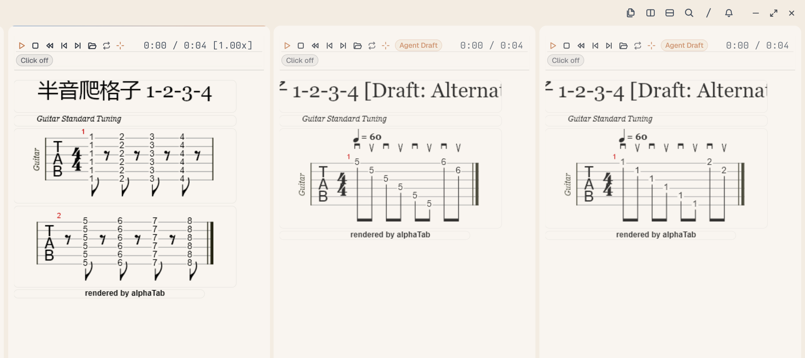

# Tern Guitar Score (`gscore`)

Interactive guitar tablature player and practice companion for [Tern](https://docs.stencil.so/tern/),
built on alphaTab (layout + SoundFont synthesis) and a resident mpv audio engine.



## What it does

- **Import & inspect.** Open `.musicxml`, `.xml`, `.mxl`, `.gp`, `.gp3`, `.gp4`, `.gp5`, and `.gpx`; all eight are exercised end to end (import, render, audio, interactive notes).
- **Play.** alphaTab's bundled Sonivox SoundFont produces normalized 44.1 kHz stereo WAV; mpv supplies the audio clock, transport, note seek, measure and A–B loops, and pitch-preserving 0.75×/1.0×/1.25× speed.
- **Count and keep time.** Use a one-bar count-in or toggle the live metronome while playing.
- **Generate practice.** Turn selected measures into alternate-picking, arpeggio, or slow-drill MusicXML; each request keeps its own selection snapshot.
- **Compare and follow.** Keep the source and multiple drafts open side by side; linked measures stay aligned, playback reveals the current system, and resizing reflows notation without regenerating audio.
- **Mix.** Mute or solo separable MIDI tracks; the live metronome follows the current track mix.
- **Agent context.** `selection.json` (`music_context_v1`) exports stable note ids, string/fret, absolute MIDI, durations, tuplets, ties, hammer-ons, slides, tuning, and time signature.

## Architecture

Four layers, each owning one concern:

```
Tern Native UI (Luau)        score panes, hit boxes, toolbar, viewport links
  ↓
Practice Controller (Luau)   transport, measure links, follow, mix state
  ↓
Score Engine (alphaTab)      layout, MIDI, PNG systems, WAV stems and click
  ↓
Audio Engine (mpv + IPC)     playback, seek, speed, loop, transport-preserving mix
```

Luau never synthesises audio and never keeps its own playback clock.

## Files

| File | Role |
| --- | --- |
| `plugin.toml` | Manifest: blocks `score` and `library`, file associations |
| `host.luau` | Blocks: rendering orchestration, hit boxes, transport, selection export |
| `window.luau` | Window commands, split layout, agent request poller |
| `hits.css` | Coordinate classes (`.gx`/`.gy`/`.gw`/`.gh`), cursor, toolbar, library |
| `renderer/index.mjs` | alphaTab → PNG systems + note/beat bounds + `full.wav` + `count_in.wav` + `track-N.wav` stems + `metronome.wav` + `tracks.json` |
| `audio_backend.py` | Resident mpv process + JSON IPC over a Windows named pipe |
| `pickfile.py` | Native Windows file dialog, filtered to score formats |

`player.py` and `slice.py` are retired: mpv seeks natively, so pre-sliced segments are no longer
needed.

## Interactive Practice Workflow (P2)

The companion turns selected measures into practice variations that open side by side:

1. **Select measures**: Click or Shift-click measures on any score pane.
2. **Request draft**:
   - **In UI**: Click the **wand button (`🪄`)**. `host.luau` writes a sentinel-terminated selection snapshot and a unique `draft_requests/req_<timestamp>_<nonce>.json`; `window.luau` consumes every complete request, generates it, and opens it beside the recorded `source_pane` (falling back to focus only if that pane closed). The sentinel detects incomplete writes; it is not a filesystem-atomic rename.
   - **Via CLI / Agent**: Run `python tools/generate_draft.py --open` to create and open a variation immediately.
3. **Musical semantics & validation**:
   - alphaTab `realValue` is checked against `expected_midi = tuning[string - 1] + fret`; incoherent notes are rejected.
   - Empty selections are rejected rather than replaced with unrelated exercises.
   - `alternate_picking`: writes MusicXML `<down-bow/>` and `<up-bow/>` stroke direction notations.
   - `arpeggio`: uses MusicXML `<pluck>` marks for right-hand fingers (`p`, `i`, `m`, `a`).
   - `slow_drill`: preserves selected notes, chords, rests, and source durations/types while applying the requested slower tempo.
4. **Practice & compare**:
   - The variation opens as a split pane beside the original score labeled `[Draft]`.
   - Existing panes are preserved (never closed) so original and variations stay side by side.
   - Each score pane keeps its own transport and audio backend; drafts can be played, looped,
     auditioned, or modified without replacing the other panes.

The generators are deterministic MusicXML templates; “Agent” refers to the request channel, not LLM-authored composition.

```bash
# Generate an alternate-picking study at 60 BPM and open beside the original
python tools/generate_draft.py --template alternate_picking --bpm 60 --open

# Generate an arpeggio study from chord tones in the selection
python tools/generate_draft.py --template arpeggio --bpm 72 --open

# Slow drill: preserve the source rhythm at the requested slower tempo
python tools/generate_draft.py --template slow_drill --bpm 50 --open
```

## P3 Practice UX

- Playback reveals the system containing the current measure, including rests; source and draft bars
  share a link keyed by the source pane and selected range.
- Pane resize re-renders notation at the new width into a revision-specific image directory. Audio
  remains in a per-pane directory and is not regenerated for layout-only resizes.
- The renderer exports an aligned click-only metronome stem. Toggling it mixes against the current
  track selection while preserving playback position, speed, pause state and A-B loop.
- Per-track Mute/Solo appears only when alphaTab reports disjoint MIDI channel sets; shared channels
  cannot be reliably separated.

## Agent interface

Drop a request file in the plugin data directory; the window half polls it every 400 ms.

```jsonc
// <plugin data>/open-request.json
{"file": "D:/scores/study.gp5"}     // open one score beside the focused pane
{"root": "D:/scores"}               // every score in a folder, one pane each
{"library": "D:/scores"}            // the library picker at that folder
{"dump": true}                      // write the current pane list to panes.txt
{"close": [123, 456]}               // close panes by id
```

Selecting bars in a score writes `<plugin data>/selection.json`:

```jsonc
{
  "version": "1.1.0",
  "protocol": "music_context_v1",
  "path": "...", "title": "...",
  "bars": [4, 7],
  "playback_range_ms": {"t0": 12470, "t1": 24940},
  "tempo_bpm": 77, "median_beat_ms": 390,
  "time_signature": [4, 4], "tuning_midi": [40, 45, 50, 55, 59, 64],
  "notes": [{"id": 1234, "bar": 4, "string": 6, "fret": 0, "midi": 40,
             "duration_ticks": 480, "is_tie": false, "is_hammer_pull": false,
             "is_slide": false, "is_ghost": false, "is_dead": false}],
  "beats": [{"t": 12470, "beat_ids": [12]}]
}
```

## Running

```bash
# Layout + audio for one score
node renderer/index.mjs --input score.gp5 --out render --audio-out audio --width 800

# The resident audio backend (started by the plugin; runnable standalone for testing)
python audio_backend.py audio
```

The plugin writes each command to an ordered file under `<cache dir>/cmds/`, followed by
`__GSCORE_END__`. The backend waits for that terminal completeness sentinel before parsing;
this detects interrupted writes but is not a filesystem-atomic publish. State is published
atomically to `audio_state.json` every 30 ms.

## Tests

All four suites use the repo-local fixture (the renderer stem test derives a two-track score from it),
so they need no private paths.

```bash
python tests/test_renderer_audio.py     # separate track stems, click stem, resize-safe audio output
python tests/test_audio_backend.py      # count-in loop reset, live mix, speed ratio, pause watchdog
python tests/test_concurrency.py        # sentinel recovery, repeated/corrupt commands, A-B bounds,
                                        # pause/resume, zero orphan mpv
python tests/test_interactive_workflow.py # P2 selection -> generation -> render -> playback
```


## Known limits

- Automated suites cover rendering, generation, and audio, but not Tern's native UI. P3 `reveal`,
  resize, toolbar, and source/draft links have been manually checked in a live host; they remain
  manual acceptance rather than CI coverage.
- Count-in length uses the first bar's numerator and initial tempo; compound metres and tempo changes
  in the count-in bar need separate validation.
- Mute/Solo is unavailable when MIDI channels overlap between tracks.
