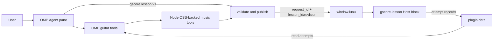

# gscore Teaching Toolkit: recommended architecture

**Decision:** keep Tern as the product surface. Reuse the existing OMP Agent terminal block for conversation and add one plugin block, `gscore.lesson`, for structured teaching material. Give OMP a small set of deterministic music tools. Do not add a separate Agent framework, Carly integration, lesson CMS, or probabilistic learner model in v1.

This report began as architecture research. The P4-B vertical slice is now implemented in this worktree; current contracts, limits, and live acceptance evidence replace the earlier unimplemented-state assumptions below.

## Current repository state

At the current worktree:

- `plugin.toml` declares `gscore.score`, `gscore.library`, and `gscore.lesson`. The Host Lesson block loads a pinned revision, displays explanations/diagrams/slash-bass quizzes, persists answers, and restores feedback on reload.
- `renderer/music_tools.mjs` uses Tonal, `@tombatossals/chords-db`, and SVGuitar; `renderer/lesson_tools.mjs` validates, publishes, and reads Lesson attempts.
- `.omp/tools` exposes `gscore_music_query`, `gscore_publish_lesson`, and `gscore_read_lesson_attempts`; `.omp/skills/guitar-tutor` describes the supported workflow.
- `window.luau` consumes unique Lesson-open requests. The gscore Host injects `GSCORE_DATA_DIR` into Tern shell launches.
- One live OMP/Tern path was exercised: calculate C/E, publish a Lesson, open its pane, click E, render correctness feedback, read the persisted attempt through OMP, and reload the pane.
- The slice is context-free and local-host scoped. It does not read the selected score into the Agent, package tools for arbitrary OMP working directories, or provide remote-host transport.

These are facts about this worktree and tested Tern host, not every published commit or remote installation.

## Product and platform boundaries

### Tern Agent pane is not a gscore plugin block

Tern distinguishes Host plugin blocks from Agent terminal panes. Keep the existing OMP Agent terminal pane as the conversational tutor; do not declare a fictitious `[[blocks]] id = "agent"`. Add `gscore.lesson` as a Host block only.

Tern runs Host and Window halves in separate Luau VMs. Host blocks define panes and render native Tern nodes; `cx.agents:start/ask` belongs to the Window API and cannot be called from `host.luau`. Therefore:

- `host.luau`: Lesson data loading, rendering, quiz events, and attempt persistence.
- `window.luau`: opening/splitting the Lesson pane; optional future “Teach selection” action that starts or prompts an Agent.
- OMP Agent process: prompt interpretation, lesson composition, and calls to OMP custom tools.

Sources: [Tern architecture](https://docs.stencil.so/tern/concepts/architecture.html), [Blocks](https://docs.stencil.so/tern/guides/blocks.html), [Window API](https://docs.stencil.so/tern/reference/api-window.html).

### Agent tools are a separate integration

OMP custom tools are executable TypeScript/JavaScript modules with schemas and `execute(...)`; skills are static prompt guidance under `.omp/skills/.../SKILL.md`. Both are discovered by OMP, not by Tern’s plugin loader. Project tools depend on the Agent’s working directory; a Tern plugin install does not automatically install them.

OMP normalizes tool calls, but model/provider support and schema behavior vary. “Works with all models” is not a safe guarantee. Promise support for OMP configurations that expose tool calling; verify each provider path. A skill can teach the model how to use the tools but cannot substitute for them.

Sources: [OMP custom tools](https://github.com/can1357/oh-my-pi/blob/main/docs/custom-tools.md), [OMP skills](https://github.com/can1357/oh-my-pi/blob/main/docs/skills.md), [provider compatibility](https://github.com/can1357/oh-my-pi/blob/main/docs/provider-compat-reference.md).

### The current file bridge is local-host scoped

Tern documents that Host I/O operates on the machine where panes run and Window I/O on the machine showing the window. A remote Host and local Window do not imply a shared filesystem. OMP is another process; do not assume it automatically knows `tern.plugin.data`.

The first Lesson flow is local-daemon/same-host only. A Host `spawn` hook injects `GSCORE_DATA_DIR` into Tern shell panes; the OMP tools fail clearly when that variable is absent. Project-level tools and the tutor skill are discovered only when OMP runs with this repository as its working directory. A live Tern shell successfully published/opened a Lesson and read its answer; a direct OMP invocation without the environment returned `DATA_DIR_UNAVAILABLE`. Remote-host support still needs an explicit cross-host transport.

Node publishes each immutable Lesson revision and unique open request with temp-file + rename. Tern attempt writes use unique filenames plus a completeness sentinel because `tern.fs.write` is non-atomic; the reader ignores incomplete or malformed records. The window removes each request after it opens. This does not provide cross-machine sharing or durable deduplication of manually copied request files.

Tern plugins are trusted code and the plugin API has no permission system. The current OMP tools expose bounded music calculations, Lesson publication, and attempt reads; they do not accept arbitrary filesystem paths or invoke arbitrary commands ([Tern security](https://docs.stencil.so/tern/concepts/security.html)).

Source: [Tern files, processes, and storage](https://docs.stencil.so/tern/guides/io.html).

## Recommended v1 architecture

### Responsibilities

| Layer | Owns | Must not own |
|---|---|---|
| OMP Agent + tutor skill | Understand the request, choose explanation depth, compose examples and next questions | Authoritative pitch math, arbitrary file writes, Tern UI rendering |
| OMP tools | Query deterministic calculations, publish validated Lessons, read attempts | Score-snapshot reads, general shell access, arbitrary paths |
| Node music/Lesson tools | Tonal calculations, curated standard-tuning shapes, validation and versioned publication | Pedagogical prose or claims of ergonomic playability |
| `gscore.lesson` Host block | Render approved activities with Tern-native nodes, handle quiz answers, persist feedback | Agent lifecycle or model prompts |
| `window.luau` | Consume Lesson-open requests and split the Lesson pane beside focus | Lesson validation or music theory |

### Small contracts

1. **Score context:** deferred. The first vertical slice accepts direct chord/theory prompts and does not read the selected score snapshot or start an Agent from a score pane. `host.luau` cannot call Window-only `cx.agents:start/ask`.
2. **Lesson payload:** stored as `gscore.lesson.v1` with `lesson_id`, integer `revision`, `goal`, and ordered activities. The current types are `explanation`, `chord_diagram`, and `quiz` with `question_type: "slash_bass"`. The service generates the question prompt, SVG, and 1-based correct-choice index; no model-authored SVG, HTML, CSS, or file path is accepted.
3. **Publication:** `gscore_publish_lesson` runs structural and deterministic music validation before writing the immutable revision and unique open request. The model cannot mark its own answer as verified.
4. **Rendering:** `gscore.lesson` uses native text, action-bearing badges, and an `image` node backed by `cx:blob`; it currently displays a curated standard-tuning chord diagram, not an interactive fretboard.
5. **Feedback:** the Host stores each answer with lesson/revision/activity IDs, selected choice, correctness, wall-clock timestamp, and a persisted ordering sequence. `gscore_read_lesson_attempts(lesson_id)` exposes complete records to OMP on a later turn. The pane restores its answer after reload.

Sources: [Tern views](https://docs.stencil.so/tern/guides/views.html), [Tern elements](https://docs.stencil.so/tern/elements/index.html), [Tern blocks](https://docs.stencil.so/tern/guides/blocks.html).

### Minimal OMP tool surface

The repo-local prototype has three tools:

- `gscore_music_query(op, ...)` — `chord.describe`, `key.describe`, `chord.detect`, `guitar.shapes`, or `guitar.diagram`.
- `gscore_publish_lesson(lesson)` — validation, immutable revision write, and Lesson-open request.
- `gscore_read_lesson_attempts(lesson_id)` — complete persisted answer records for adaptation.

No selected-score context reader exists yet. OMP project tools depend on the Agent working directory; the Tern plugin install alone does not install them. Other model/provider paths have not been tested.

## Music computation and validation

**Implementation:** deterministic calculations stay in Node under `renderer/music_tools.mjs`; the thin OMP adapter calls the same code through Node, reusing the renderer's installed dependencies.

- `tonal@6.5.1` supplies chord spelling/detection, keys, scales, intervals, transposition and generic voice-leading operations. It does not solve guitar string/fret positions.
- `@tombatossals/chords-db@0.5.1` is curated guitar-position data, not a solver. The published package root declares a missing `index.js`; the prototype pins the version and imports `lib/guitar.json` directly. Its guitar data covers standard tuning.
- `svguitar@2.10.1` renders static chord diagrams. The adapter strips SVG elements Tern does not allow and tests the remaining element set and `viewBox`; a Tern Host must still upload the SVG with `cx:blob` and render an `image` node.
- `music21` is a candidate if key-aware Roman-numeral analysis becomes a real requirement. Rust `kord` also provides theory APIs and CLI/WASM, but duplicates this Node workload without a demonstrated performance need. Do not add Rust for v1.
- Do not build a general guitar voicing solver yet. If curated positions fail a concrete requirement, test a dedicated solver before writing one.

The current validator recalculates database-shape pitches, rejects shapes whose notes are outside the chord, generates sanitized SVG from the selected shape, and derives the slash-bass quiz prompt and answer index from Tonal results. It rejects wrong answer keys, invalid note choices, and unsupported activity types. The database remains a curated shape source, not a general solver.

See [open-source music tooling research](gscore-open-source-music-tools.md) for source links and API evidence.

Sources: [Tonal.js Chords](https://tonaljs.github.io/tonal/docs/groups/chords), [music21 RomanNumeral](https://music21.org/music21docs/moduleReference/moduleRoman.html), [music21 Chordify](https://music21.org/music21docs/usersGuide/usersGuide_09_chordify.html).

## First vertical slice: chord inversions

Avoid automatic harmonic analysis of arbitrary score passages at first. Use an explicit chord prompt, for example “teach me C major inversions,” then add selected-score context as a second path.

1. Agent calls `gscore_music_query` for `chord.describe` and `guitar.shapes`.
2. Agent composes an explanation, a `chord_diagram`, and a slash-bass quiz.
3. `gscore_publish_lesson` generates the diagram and prompt, validates the calculated bass against the answer key, and publishes a revision.
4. The window opens `gscore.lesson`; the learner clicks an answer and sees deterministic feedback.
5. On a later turn, OMP reads the persisted attempt; the Agent can adapt its next explanation. Automatic follow-up generation is not implemented.

This tests dynamic teaching without a prewritten lesson corpus. It does not require scale analysis, Roman-numeral inference, audio transcription, a CMS, or a global learner model.

## Recommended next direction: bounded generative scenes

The current activity types are a working vertical slice and useful semantic renderers, not the product ceiling. Shift the roadmap toward Agent-selected visual composition, but keep the renderer in control of pixels and music facts.

First `gscore.scene.v1` should compose a small closed set of semantic nodes (text, calculator-backed chord/score facts, and labelled relationships) using renderer-owned `stack` or `row` layout. It belongs inside a new explicit `gscore.lesson.v2`: the current `gscore.lesson.v1` validator rejects unsupported activity types, so leave v1 revisions and readers unchanged.

Keep publishing immutable full Lesson revisions; an Agent's follow-up can publish a revised scene. Defer low-level freeform primitives, arbitrary coordinates, partial patch APIs, and a general layout engine until a real lesson cannot be expressed with semantic nodes and relationships.

Use a deterministic comparison such as chord tones versus slash bass to validate the scene path. Treat claims such as a progression being “more natural” as context-dependent unless concrete voicings and the comparison criterion are supplied.

Prior-art comparison: [Generative UI DSLs](generative-ui-dsl-prior-art.md).

## Learner state: evidence before mastery claims

Persist observable per-lesson attempts first: answer, deterministic correctness where applicable, hint use, and optional self-report. Do not infer playing accuracy or technique without recorded audio or explicit feedback. Do not implement Bayesian Knowledge Tracing, skill mastery probabilities, or a global skill graph until actual usage justifies them.

A systematic review of AI-driven intelligent tutoring systems in K–12 found positive effects overall, with smaller benefits against non-intelligent tutoring comparators and a need for longer interventions and more diverse samples. It does not establish efficacy for adult guitar teaching; use it as background, not a product guarantee.

Source: [Systematic review of AI-driven ITS in K–12 education](https://pmc.ncbi.nlm.nih.gov/articles/PMC12078640/).

## Acceptance gates

| Gate | Evidence required |
|---|---|
| Music calculations | 20 Node tests pass for music and Lesson behavior; the Bun OMP-adapter normalization check passes. Independent alphaTab `realValue` comparisons, transposing instruments, and special techniques remain unverified. |
| Tool/runtime integration | Pass for one OMP model launched from a Tern shell with repository cwd; calculator, publish, and attempt-read tools were exercised. Other providers and arbitrary project directories are untested. |
| Lesson lifecycle | One live C/E lesson passed publish → pane open → quiz click → persisted attempt read → plugin reload with feedback restored. |
| Provider scope | One OMP provider/model path only; compatibility with other supported providers remains open and does not imply support for every model. |
| UI acceptance | The one Lesson path was clicked through Tern's live control scenario. This does not validate P3 follow/reflow/mix/link behavior or score-selection context. |

## Deferred by design

- Carly exports or an MCP server alongside OMP.
- A lesson catalog, CMS, or course-authoring UI.
- Audio transcription, chord recognition from recordings, or OMR.
- Probabilistic learner modeling and mastery claims.
- Remote-host Lesson publication before a real cross-host transport exists.
- Defer Rust, music21, and a custom guitar voicing solver until a concrete feature exceeds Tonal plus curated shape data.

## Sources

- Tern: [Architecture](https://docs.stencil.so/tern/concepts/architecture.html) · [Blocks](https://docs.stencil.so/tern/guides/blocks.html) · [Window API](https://docs.stencil.so/tern/reference/api-window.html) · [Files, Processes, and Storage](https://docs.stencil.so/tern/guides/io.html) · [Building Views](https://docs.stencil.so/tern/guides/views.html) · [Elements](https://docs.stencil.so/tern/elements/index.html)
- OMP: [Custom tools](https://github.com/can1357/oh-my-pi/blob/main/docs/custom-tools.md) · [Skills](https://github.com/can1357/oh-my-pi/blob/main/docs/skills.md) · [Provider compatibility](https://github.com/can1357/oh-my-pi/blob/main/docs/provider-compat-reference.md)
- Music theory: [Tonal.js Chords](https://tonaljs.github.io/tonal/docs/groups/chords) · [music21 RomanNumeral](https://music21.org/music21docs/moduleReference/moduleRoman.html) · [music21 Chordify](https://music21.org/music21docs/usersGuide/usersGuide_09_chordify.html)
- Tutoring evidence: [Systematic review of AI-driven ITS in K–12 education](https://pmc.ncbi.nlm.nih.gov/articles/PMC12078640/)
