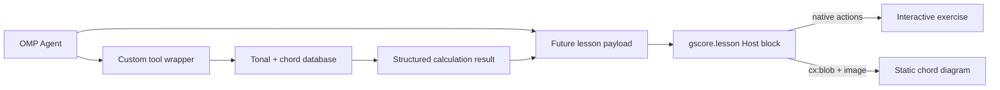

# Open-Source Music Tools for gscore

**Date:** 2026-11-02
**Status:** Historical research snapshot. The Node calculator, OMP wrappers, and Tern-native `gscore.lesson.v2` slice have since been implemented; see the P4-B section of the README for current scope and live acceptance.

## Decision

Use the existing Node renderer runtime as the deterministic music-calculation seam. Use **Tonal** for chord/key/scale/note operations, **chords-db** as a curated standard-tuning guitar-shape data source, and **SVGuitar** for static chord diagrams. Keep the Agent responsible for teaching choices and explanations, not arithmetic.

Do not add Rust for this slice. Rust **Kord** exists and exposes theory through a CLI and Rust/WASM library, but it duplicates the current Node use case and adds a second runtime/build path without a measured performance need. Reconsider Rust only for a future CPU-bound audio/DSP workload or a requirement that existing libraries cannot satisfy.

## Initial prototype interface

`renderer/music_tools.mjs` accepts one JSON object on stdin and prints one JSON object on stdout. The response envelope is `gscore.music.v1` with `ok`, `op`, and either `result` or a structured `error`.

```json
{"op":"chord.describe","symbol":"Cmaj7"}
```

Implemented operations:

| Operation | Library-backed result | Current boundary |
|---|---|---|
| `chord.describe` | Tonal chord name, quality, tones, slash bass when present, and intervals | Explicit chord symbol only |
| `key.describe` | Major-key scale/triads/seventh chords; natural, harmonic, and melodic minor forms | Does not infer a key from a score |
| `chord.detect` | Tonal chord candidates from note names | Candidate list can be ambiguous; the Agent must not present it as unique without context |
| `guitar.shapes` | Curated database positions, with note names and MIDI recalculated through Tonal | Standard tuning; slash bass is enforced when the database has a matching shape; lookup only, not a fingering solver |
| `guitar.diagram` | SVGuitar static diagram for a selected database position | Static image; no per-note pointer events |

Examples exercised against the installed packages:

- `Cmaj7` → notes `C E G B`, intervals `1P 3M 5P 7M`.
- C major → scale `C D E F G A B`, triads `C Dm Em F G Am Bdim`.
- A minor → natural/harmonic/melodic scales returned as distinct results.
- `D F# A C` → Tonal identifies `D7`.
- The database's open C shape `x32010` → Tonal independently recalculates `C3 E3 G3 C4 E4` / MIDI `48 52 55 60 64`; positions whose recalculated pitches fall outside the requested chord are rejected.
- `C/E` keeps bass `E`; returned shapes are filtered so their lowest sounding MIDI pitch is E. No matching shape returns `NOT_FOUND` rather than silently dropping the inversion.

Run `npm --prefix renderer run test:toolkit` from the plugin root for the current calculator, Lesson, and OMP-tool tests.

## Calculator library assessment

| Library | Use | Assessment |
|---|---|---|
| [Tonal](https://tonaljs.github.io/tonal/) — MIT, `tonal@6.5.1` | Chord spelling/detection, intervals, keys/scales, transposition, generic voicing/voice-leading | Best fit for the existing Node path. `Voicing.search` returns note sets, not guitar string/fret layouts. The API is directly exercised by the adapter tests. |
| [@tombatossals/chords-db](https://github.com/tombatossals/chords-db) — MIT, pinned `0.5.1` | Guitar, ukulele, piano chord-position data | Reuse the curated guitar JSON; it is data, not a solver, and the inspected guitar tuning is standard E-A-D-G-B-E. **Packaging caveat:** the published package declares `main: index.js`, but that file is absent from the installed tarball and importing the package root fails. The adapter imports the pinned `lib/guitar.json` subpath directly. |
| [music21](https://music21.org/music21docs/moduleReference/moduleRoman.html) — BSD-3-Clause | Key-aware Roman-numeral and symbolic-score analysis | Useful if Roman-numeral analysis becomes a first-class feature. Defer the broader Python toolkit until that requirement exists; it does not remove contextual ambiguity from harmonic interpretation. |
| [Kord](https://github.com/twitchax/kord) — MIT | Chord/scale description, note-set chord guessing, audio analysis; Rust library, CLI and WASM | Valid Rust option, but not a guitar fingering solver. No advantage over Tonal for the current deterministic Node operations. |

A general playable-voicing search remains an open capability gap: the surveyed packages either supply generic note voicings or curated chord shapes, not a mature arbitrary tuning/capo/fret-constraint guitar solver. Do not build one pre-emptively. If curated shapes fail a real teaching task, evaluate a dedicated solver before implementing one.

## Visualization options and Tern fit

| Tool | What it provides | Fit for this plugin |
|---|---|---|
| [SVGuitar](https://github.com/omnibrain/svguitar) — MIT, `2.10.1` | Configurable guitar chord diagrams; SVG string output; supports headless Node | Selected for static chord images. In Node 24, the imported ESM bundle did not see `registerWindow` from the separately loaded SVG.js module. Requiring SVGuitar after briefly registering an `svgdom` `window`/`document` worked. The adapter removes `<title>`, `<style>`, and `<tspan>` because Tern drops those elements, then tests that the SVG has a `viewBox` and only Tern-allowed element names. |
| [Fretboard.js](https://github.com/moonwave99/fretboard.js) — ISC | Guitar/bass fretboard SVG, scale boxes, arpeggios, chord shapes, interaction API | Broader neck diagrams than SVGuitar, but its latest repository push is 2023-03-04. Candidate for evaluation if a full-neck diagram is required; not selected for the first slice. |
| [piano-chart](https://github.com/ailon/piano-chart) — MIT | Browser piano keyboard with note highlights, key down/up and click events | DOM-backed. Suitable for a browser surface, not directly reusable in a Tern Host block. |
| [claviature](https://github.com/felixroos/claviature) | Framework-neutral piano SVG element tree and labels | Promising static representation, but its `LICENSE` dedicates the work under Unlicense while `package.json` says ISC. Avoid adding it until that license metadata is reconciled. |
| [chordkit](https://github.com/juliocarneiro/chordkit) — MIT | Zero-dependency SVG chord renderer, dictionary and browser editor | Technically attractive static-SVG alternative. The repository has low adoption (8 stars at research time); keep it as a future comparison rather than adding another diagram dependency now. |

At research time, the prototype test confirmed the SVG element allowlist and `viewBox` but did not exercise a real Tern pane. The later v2 Tern acceptance is recorded in the README.

For interactive fretboard positions or piano keys, use Tern-native rows/buttons/actions and attach the computed note to each action. An SVG image is static apart from a click on the whole image; it is not a per-string/per-key interaction surface.

## Integration boundary

The research-time integration recommendation was a thin OMP wrapper around the tested module. The implemented wrapper is `.omp/tools/gscore.ts`; it reuses the same calculator module rather than adding a second implementation.



At research time, neither the OMP wrapper nor Lesson publication had been implemented. Both now exist; see `.omp/tools/lesson.ts` and the README's v2 acceptance record.

## Verification and limits

At research time, `npm --prefix renderer run test:music` passed 9 tests. The current `test:toolkit` command covers music, Lesson, and OMP request behavior.

Verified: Node library imports, JSON request/response behavior, selected music facts against hand-authored expected values, slash-bass filtering, shape pitch recalculation, and compatibility with Tern's documented SVG element contract.

At research time, no live Tern pane, OMP tool discovery, or interactive pitch events had been verified. Those have since been exercised for the v2 C/C/E slice; other providers, arbitrary guitar tunings/capo search, and general fretboard/piano interaction remain unverified.

## Sources

- [Tonal chord API](https://tonaljs.github.io/tonal/docs/groups/chords) · [Tonal key API](https://tonaljs.github.io/tonal/docs/harmony/keys) · [Tonal voicing API](https://github.com/tonaljs/tonal/blob/main/packages/voicing/README.md)
- [Chord database repository](https://github.com/tombatossals/chords-db) · [guitar database format](https://github.com/tombatossals/chords-db/blob/master/src/db/guitar/chords/C/major.js) · [shape pitch processing](https://github.com/tombatossals/chords-db/blob/master/src/tools.js)
- [SVGuitar README and headless usage](https://github.com/omnibrain/svguitar/blob/master/README.md) · [SVGuitar package manifest](https://github.com/omnibrain/svguitar/blob/master/package.json)
- [Tern image/SVG contract](https://docs.stencil.so/tern/elements/data.html) · [Tern Host API](https://docs.stencil.so/tern/reference/api-host.html)
- [Fretboard.js](https://github.com/moonwave99/fretboard.js) · [piano-chart](https://github.com/ailon/piano-chart) · [claviature README](https://github.com/felixroos/claviature/blob/main/README.md) · [claviature LICENSE](https://github.com/felixroos/claviature/blob/main/LICENSE) · [claviature package metadata](https://github.com/felixroos/claviature/blob/main/package.json)
- [Chordkit](https://github.com/juliocarneiro/chordkit) · [music21 Roman numerals](https://music21.org/music21docs/moduleReference/moduleRoman.html) · [Rust Kord](https://github.com/twitchax/kord)
- [OMP custom tools](https://github.com/can1357/oh-my-pi/blob/main/docs/custom-tools.md)
